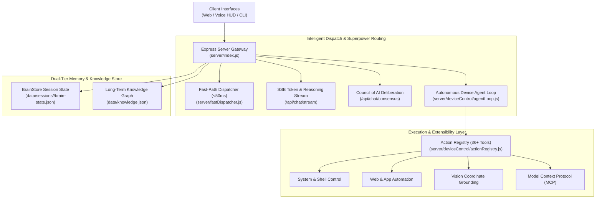

# 🤖 AGENT.md — Sia Autonomous Agent & Multi-Model Orchestrator Spec

> **Sia AI** is an advanced autonomous personal agent, device orchestrator, and voice companion operating with the poise, intelligence, and execution speed of Tony Stark's **J.A.R.V.I.S.** protocol.

---

## 🏛️ 1. Architecture Overview



---

## ⚡ 2. Core Subsystems

### 2.1 Fast-Path Direct Intent Dispatcher (`server/fastDispatcher.js`)
- **Latency**: `<50ms` execution without waiting for multi-turn LLM inference.
- **Matched Intents**:
  - **App & Web Launching**: `open/launch/go to <app>` (e.g. YouTube, Spotify, WhatsApp, Flipkart, Amazon, Gmail, Netflix, Discord).
  - **Shopping & E-Commerce**: `open flipkart and place order for <item>`, `order <item> on amazon`.
  - **Media Playback**: `play <song/video> on youtube/spotify`.
  - **Direct Shell Execution**: `run command <cmd>`, `run shell <cmd>`.
  - **Telephony & Calling**: `call <number/contact>`, `dial <number>`.
  - **System Volume & Screenshots**: `mute`, `unmute`, `take screenshot`.
  - **Compound Chaining**: `open youtube and play lo-fi and mute volume`.

### 2.2 Autonomous Device Agent Loop (`server/deviceControl/agentLoop.js`)
- **Multi-Turn Function Calling**: Handles complex, multi-step tasks across host Windows OS and paired Android devices.
- **Execution Directives**:
  - **100% Autonomous**: Infers missing parameters and carries out instructions completely without asking clarifying questions or confirmation prompts.
  - **Window Reuse**: Automatically focuses and reuses existing open browser tabs instead of opening duplicates.
  - **Strict Anti-Hallucination**: Reports tool outcomes grounded strictly in verified programmatic execution results.

### 2.3 Real-Time SSE Token & Neural Reasoning Streaming (`/api/chat/stream`)
- **First-Token Latency**: Sub-second streaming directly from OpenRouter.
- **Chain-of-Thought (CoT) Extraction**: Live streaming of internal reasoning tokens into a collapsible UI HUD for reasoning models (DeepSeek-R1, Claude 3.7 Thinking, Gemini Flash Thinking).
- **Interactive Markdown & Code Syntax**: Automatically parses fenced code blocks with language tags and copy-to-clipboard buttons.

### 2.4 "Council of AI" Multi-Model Consensus Engine (`server/consensusEngine.js`)
- Simultaneously queries 3 frontier models:
  1. **Claude Sonnet 5** (`anthropic/claude-sonnet-5`) — Architecture, nuance, and depth.
  2. **DeepSeek R1** (`deepseek/deepseek-r1`) — Deep reasoning and first-principles logic.
  3. **GPT-5.4 Mini** (`openai/gpt-5.4-mini`) — Omni knowledge and pragmatic synthesis.
- Sia synthesizes a unified master answer highlighting consensus and resolving divergences alongside individual perspective cards.

---

## 🛠️ 3. Registered Tool Capabilities (`actionRegistry.js`)

| Category | Available Tools | Description |
| :--- | :--- | :--- |
| **System & Shell** | `run_command`, `run_script`, `take_screenshot`, `set_volume`, `get_system_info` | Execute terminal commands, capture screen, adjust sound, and query specs. |
| **Filesystem** | `list_dir`, `read_file`, `write_file`, `move_file`, `delete_file` | Full workspace file manipulation and code generation. |
| **Web & Browsing** | `open_url`, `open_app`, `search_web`, `read_web_page` | Browser automation, search query execution, and web scraping. |
| **Communication** | `send_whatsapp_message`, `read_whatsapp_messages`, `place_call`, `send_instagram_message` | WhatsApp messaging, automated telecom dialers, and social messaging. |
| **UI Automation** | `ui_click`, `ui_type`, `ui_press_key`, `ground_ui_element`, `verify_action_result` | Coordinate-based input, keystroke typing, and visual verification. |
| **Model Context Protocol** | Dynamic MCP Tools (GitHub, Postgres, Brave Search, etc.) | External community tool discovery via `data/mcp_servers.json`. |

---

## 🧠 4. Memory & Knowledge Graph Architecture

Sia utilizes a **dual-tier memory model**:

```
data/
├── knowledge.json                              <-- Global long-term knowledge graph
├── mcp_servers.json                            <-- External MCP server configurations
└── sessions/
    └── <sessionId>/
        ├── brain-state.json                    <-- Machine-readable session state
        ├── brain.md                            <-- Human-readable markdown mirror
        └── knowledge.json                      <-- Per-session extracted knowledge
```

### Knowledge Graph Structure (`server/memory/knowledgeGraph.js`)
- **User Profile & Preferences**: Name, coding style, interface preferences.
- **Active Projects**: Tracked repositories, ongoing implementations, and technical stacks.
- **Contacts**: Telephone numbers, emails, handles, and affiliations.
- **Persistent Facts**: Atomic facts automatically extracted by a background AI worker during conversation without blocking turns.

---

## 🎙️ 5. Live Voice 2.0 with Instant Barge-In

- **Continuous Hands-Free Interaction**: Glowing reactive arc-reactor orb visualizer.
- **Instant Vocal Energy Barge-In**: Web Audio API energy analyzer immediately cuts assistant TTS speech the moment the user starts speaking.
- **Snappy Pause Buffer**: Dispatches instructions in **`700ms`** after speech concludes.
- **Multi-Engine TTS**: Supports browser native speech synthesis and high-fidelity neural voices via ElevenLabs.

---

## 🌐 6. API Endpoints Quick Reference

| Method | Endpoint | Description |
| :--- | :--- | :--- |
| `POST` | `/api/chat` | Standard single-turn chat with auto-routing. |
| `POST` | `/api/chat/stream` | Server-Sent Events (SSE) token and reasoning streaming. |
| `POST` | `/api/chat/consensus` | Multi-model Council of AI parallel deliberation. |
| `POST` | `/api/files/process` | Multimodal parser for images (Base64), CSVs, PDFs, and code. |
| `GET` | `/api/models` | List of 460+ online models and 27 superpower categories. |
| `GET` | `/api/memory/knowledge` | Retrieve user preferences, projects, contacts, and facts. |
| `POST` | `/api/memory/knowledge` | Manually add a persistent fact to the knowledge graph. |
| `DELETE`| `/api/memory/knowledge/:id` | Remove a fact from the knowledge graph. |
| `GET` | `/api/mcp/servers` | Discover active Model Context Protocol tool servers. |
| `POST` | `/api/device/command` | Trigger direct autonomous device agent loop. |

---

## 🚀 7. Running & Testing

```bash
# 1. Install dependencies
npm install

# 2. Start Sia Orchestrator
npm start

# 3. Access Web & Voice UI
http://localhost:3000
```
